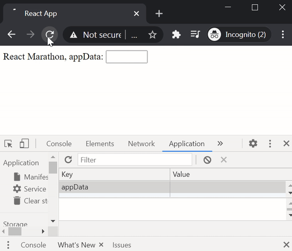

# React Practical

## The task of the topic "Hooks"

There is the functional component `App` which renders one `div` with the text `React Marathon, appData:` and an `input`.

Using `useState` and `useEffect`, when the page loads, read the `localStorage` key `appData` and put that value into the `input`.

Editing `appData` in DevTools does not change the field until the page is loaded again.

### Example
<kbd>
  
</kbd>

### Run locally

Node.js 22 or newer.

```bash
npm install
npm run dev
npm test
```

`npm test` fails on the starter and passes after the task is done.
